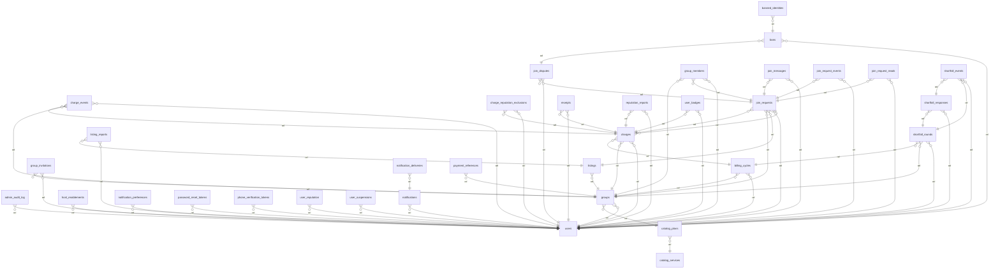

> Padre: [[BD]]

# Relaciones entre tablas

38 tablas. Relaciones por clave foránea extraídas de las migraciones (la flecha va de la tabla hija a la tabla referenciada):

Tablas: `admin_audit_log`, `banned_identities`, `bans`, `billing_cycles`, `catalog_plans`, `catalog_services`, `charge_events`, `charge_reputation_exclusions`, `charges`, `group_invitations`, `group_members`, `groups`, `host_enablements`, `job_runs`, `join_disputes`, `join_messages`, `join_request_events`, `join_request_reads`, `join_requests`, `listing_reports`, `listings`, `notification_deliveries`, `notification_preferences`, `notifications`, `password_reset_tokens`, `payment_references`, `phone_verification_tokens`, `rate_limit_events`, `receipts`, `reputation_reports`, `shortfall_events`, `shortfall_responses`, `shortfall_rounds`, `telegram_updates`, `user_badges`, `user_reputation`, `user_suspensions`, `users`.

Detalle por área en las notas `BD-Esquema-*` (enlazadas desde [[BD]]).
