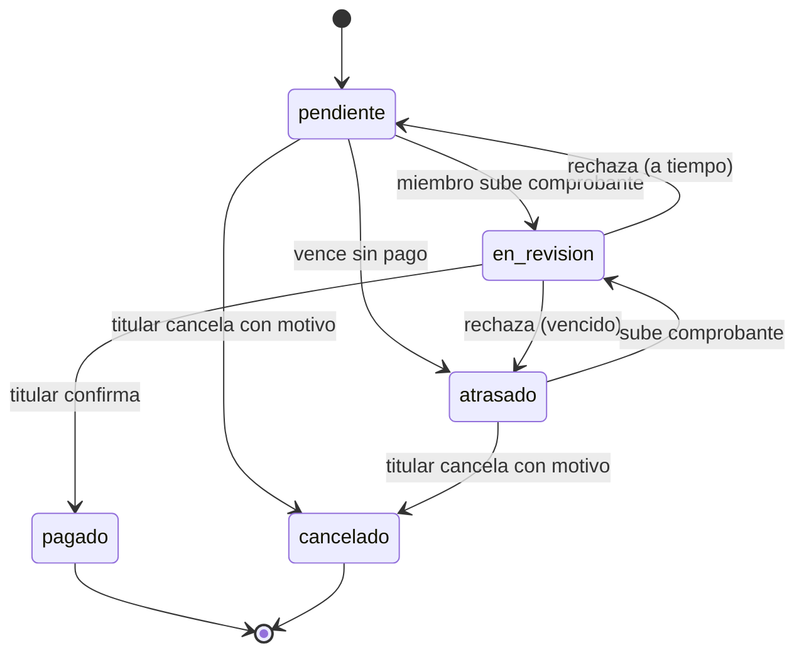

> Padre: [[Dominio]]

# Estados de un cobro

- Final: `pagado` y `cancelado`. No se inventan estados.
- Vencido = fecha de corte + 3 días sin pago: pasa a `atrasado` y el miembro es retirado; la deuda queda visible y no puede volver a ese grupo hasta saldarla.
- El **cobro de ingreso** nace `pagado` al confirmar la solicitud ([[Ingreso-al-grupo]]).
- El miembro nunca confirma su propio pago; el titular no genera cobro propio (RN-002-03).
- Tabla completa de transiciones: [[Spec-002-texto-completo]] (RN-002-01). Implementación: `charge-state` en [[BE-billing]]. Reputación: un cobro `atrasado` cuenta como no puntual ([[Reputacion-reglas]]).
