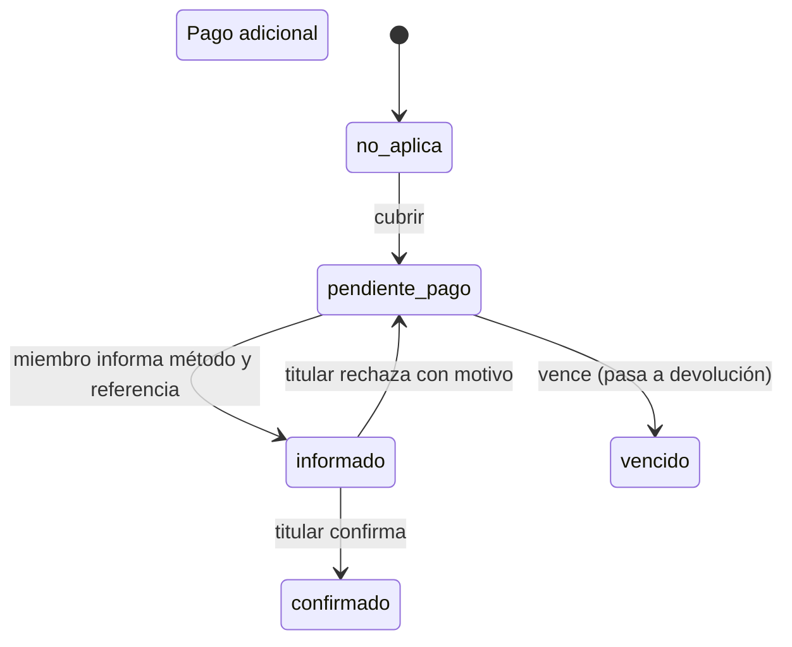

> Padre: [[Dominio]]

# Faltante de grupo

Spec: [[Spec-011-faltante-de-grupo]]. Plazos supuestos: [[Decision-plazos-faltante-grupo]].

- **Cotización:** `cuota_nueva = floor(T / m')`, donde `T` es el total del ciclo y `m'` los miembros activos que se quedan (titular incluido). A cada afectado le toca `max(cuota_nueva − pagado, 0)`; el resto lo absorbe el titular. No se relee precio ni tipo de cambio.
- **Afectado:** miembro activo, distinto del titular, con cobro `pagado` menor que la cuota nueva.
- **Ronda:** una abierta por grupo y hasta 2 por período; cancelar equivale a absorber mientras nadie haya respondido.

Devolución: `pendiente → enviada → confirmada | disputada` (disputa también si el titular no registra en 5 días). El silencio equivale a pedir devolución. Todo en centavos y con línea de tiempo de solo anexado.
