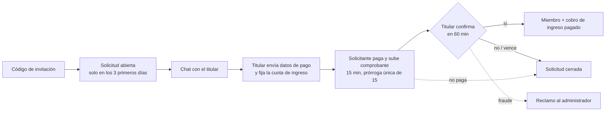

> Padre: [[Dominio]]

# Ingreso al grupo

Decisión: [[ADR-0004-ingreso-con-pago-previo-y-chat]]. Spec: [[Spec-010-solicitudes-de-ingreso]].

Reglas clave: nadie entra a mitad de período; cuota de ingreso = precio del mes entre los miembros que tendrá el grupo con la persona incluida; el chat (texto y fotos) no se edita ni se borra y se conserva 2 meses; referencia de pago obligatoria y única por grupo; baneo bloquea correo, celular, cédula y Telegram. Límites de la protección: Vaquita no custodia dinero ([[Riesgos-y-fraude]]).
